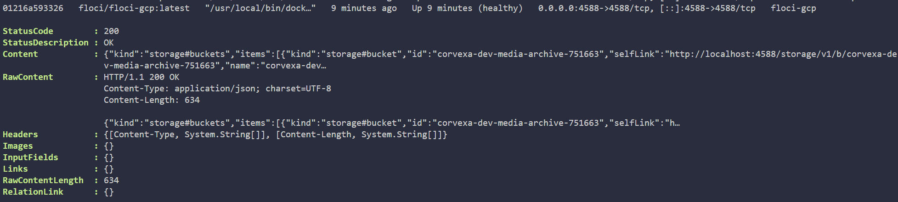
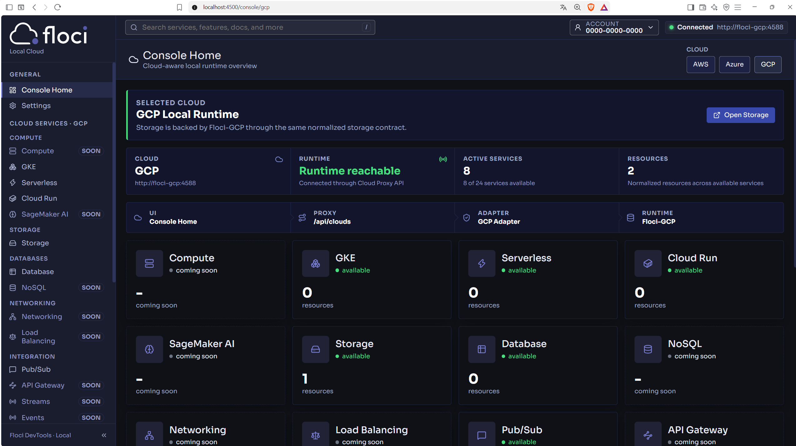
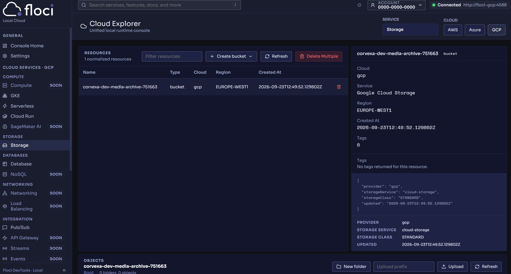
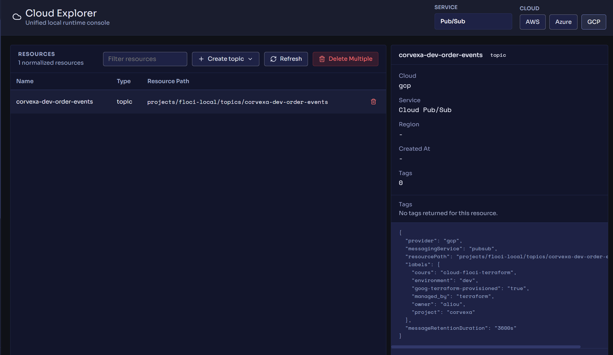
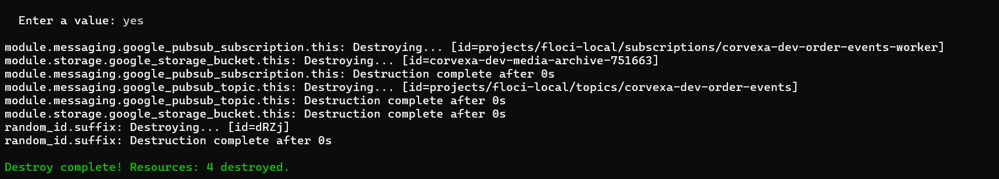
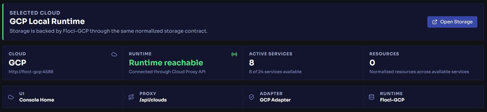

# Cloud, Floci, and Terraform — GCP (Cloud Storage + Pub/Sub)

Deployment of two **Google Cloud Platform (GCP)** services using **Terraform** against the local emulator **Floci-GCP**, verified with **Floci UI**.

The implemented scenario simulates an order processing microservice: order-related files are archived in a **Cloud Storage** bucket, and each order emits an event to a **Pub/Sub** topic consumed by an asynchronous processing worker.

## Table of Contents

1. [Provider & Selected Services](#1-provider--selected-services)
2. [Prerequisites](#2-prerequisites)
3. [Running Floci-GCP](#3-running-floci-gcp)
4. [Running Floci UI](#4-running-floci-ui)
5. [Terraform Configuration](#5-terraform-configuration)
6. [Project Structure](#6-project-structure)
7. [Variables, tfvars, and Locals](#7-variables-tfvars-and-locals)
8. [Modules and Outputs](#8-modules-and-outputs)
9. [Dev and Prod Environments](#9-dev-and-prod-environments)
10. [Terraform Tests](#10-terraform-tests)
11. [Module Documentation](#11-module-documentation)
12. [Deployment Lifecycle](#12-deployment-lifecycle)
13. [Verification in Floci UI](#13-verification-in-floci-ui)
14. [Teardown & Destruction](#14-teardown--destruction)
15. [References](#15-references)

---

## 1. Provider & Selected Services

**Provider: GCP**, via the [`floci-gcp`](https://github.com/floci-io/floci-gcp) local emulator (port `4588`).

| # | Service | Primary Terraform Resource |
|---|---|---|
| 1 | **Cloud Storage** — Media archive | `google_storage_bucket` |
| 2 | **Pub/Sub** — Order event bus | `google_pubsub_topic` + `google_pubsub_subscription` |

Cloud Storage and Pub/Sub represent two essential GCP building blocks (object storage and asynchronous event messaging). Rather than standalone toys, they are linked in a realistic architectural workflow. Both services are exposed by Floci-GCP via standard REST endpoints without requiring Docker-in-Docker components, ensuring fast and reliable local emulation.

---

## 2. Prerequisites

- [Docker Desktop](https://www.docker.com/products/docker-desktop/)
- [Terraform](https://developer.hashicorp.com/terraform/install) ≥ 1.7.0 (required for `terraform test`)
- [Git](https://git-scm.com/)
- Optional: [terraform-docs](https://terraform-docs.io/user-guide/installation/) to re-generate module documentation

---

## 3. Running Floci-GCP

Floci-GCP is the Google Cloud emulator from the Floci family. It exposes all emulated services through a single entrypoint on port **4588**.

```bash
docker compose up -d
```

Verify that Floci-GCP is running:

```bash
docker ps
curl "http://localhost:4588/storage/v1/b?project=floci-local"
```

The `floci-gcp` container must display `Up` status, and the `curl` probe should return `{"kind":"storage#buckets", ...}`.



---

## 4. Running Floci UI

Floci UI is an exploratory web interface that can be cloned and run alongside:

```bash
git clone https://github.com/floci-io/floci-ui.git ../floci-ui
cd ../floci-ui
docker compose up -d --no-deps floci-ui floci-api
docker network connect floci_default floci-gcp
```

Endpoints:
- Frontend: `http://localhost:4500`
- API: `http://localhost:4501`

In the UI:
1. Select the **GCP** provider.
2. Confirm the runtime endpoint is accessible (`http://floci-gcp:4588`).
3. Browse available services — **Storage** and **Pub/Sub** are utilized in this configuration.



---

## 5. Terraform Configuration

[`providers.tf`](providers.tf) configures the standard `google` provider to target Floci-GCP instead of public Google Cloud endpoints:

```hcl
provider "google" {
  project = var.gcp_project
  region  = var.gcp_region

  access_token = "floci-local-token"

  storage_custom_endpoint = "http://${var.floci_gcp_host}/storage/v1/"
  pubsub_custom_endpoint  = "http://${var.floci_gcp_host}/v1/"
}
```

### Real Cloud Provider vs Local Floci Emulator
- **Public GCP:** The provider authenticates via a Service Account (JSON key file or Workload Identity / ADC) and sends requests to `storage.googleapis.com` and `pubsub.googleapis.com`, incurring real billing.
- **Floci Emulator:** `access_token` accepts any arbitrary dummy token, while `storage_custom_endpoint` and `pubsub_custom_endpoint` redirect Terraform API calls to `localhost:4588`.

All Terraform resources (`google_storage_bucket`, `google_pubsub_topic`, etc.) remain **100% identical**. Moving from local emulation to production GCP requires only removing the custom endpoint lines and providing valid IAM credentials.

The GCP project name (`floci-local`) is fixed in the emulator; no pre-existing container or tenant setup is needed.

---

## 6. Project Structure

```text
.
├── README.md                   # Project documentation
├── main.tf                     # Unique random suffix + module invocations
├── providers.tf                # Google provider targeting Floci-GCP
├── variables.tf                # Root variables with strict validation rules
├── locals.tf                   # resource_prefix, normalized naming, common labels
├── outputs.tf                  # Exposed service endpoints and resource IDs
├── versions.tf                 # Terraform >= 1.7.0 and provider constraints
├── terraform.tfvars            # Default configuration values (dev environment)
├── docker-compose.yml          # Floci-GCP container runner
├── .terraform-docs.yml         # Module documentation generator configuration
├── envs/
│   ├── dev.tfvars              # Development environment settings
│   └── prod.tfvars             # Production environment settings
├── tests/
│   ├── storage.tftest.hcl      # Unit and validation tests for storage module
│   └── messaging.tftest.hcl    # Unit and validation tests for messaging module
├── modules/
│   ├── storage/                # Reusable Google Cloud Storage module
│   │   ├── main.tf
│   │   ├── variables.tf
│   │   ├── outputs.tf
│   │   └── README.md
│   └── messaging/              # Reusable Pub/Sub topic & subscription module
│       ├── main.tf
│       ├── variables.tf
│       ├── outputs.tf
│       └── README.md
└── screenshots/                # Validation evidence from Floci UI and CLI
    ├── floci.png
    ├── floci-ui.png
    ├── resources.png
    ├── resources-pubsub.png
    ├── destroy-confirmation.png
    └── destroy.png
```

---

## 7. Variables, tfvars, and Locals

All input variables are declared in [`variables.tf`](variables.tf) with robust validation blocks:
- Project naming formats and character restrictions
- Environment restricted strictly to `dev` or `prod`
- GCP region restricted to a known whitelist
- Storage classes constrained to valid GCP classes (`STANDARD`, `NEARLINE`, `COLDLINE`, `ARCHIVE`)
- Pub/Sub retention bounded between `600s` and `604800s` (10 minutes to 7 days)
- Pub/Sub ack deadline bounded between `10s` and `600s`

[`locals.tf`](locals.tf) standardizes naming conventions across all resources:

```hcl
locals {
  resource_prefix = "${var.project_name}-${var.environment}"

  bucket_name_base = substr(
    lower(replace(local.resource_prefix, "/[^a-z0-9-]/", "")),
    0, 40
  )

  common_labels = merge(var.labels, {
    project     = var.project_name
    environment = var.environment
    managed_by  = "terraform"
  })
}
```

---

## 8. Modules and Outputs

Both services are modularized under `modules/storage` and `modules/messaging` without hardcoded values:

```hcl
module "storage" {
  source             = "./modules/storage"
  bucket_name        = "${local.bucket_name_base}-media-archive-${random_id.suffix.hex}"
  project            = var.gcp_project
  region             = var.gcp_region
  storage_class      = var.storage_class
  force_destroy      = var.bucket_force_destroy
  versioning_enabled = var.bucket_versioning_enabled
  labels             = local.common_labels
}

module "messaging" {
  source                     = "./modules/messaging"
  topic_name                 = "${local.resource_prefix}-order-events"
  subscription_name          = "${local.resource_prefix}-order-events-worker"
  project                    = var.gcp_project
  message_retention_duration = var.pubsub_message_retention_duration
  ack_deadline_seconds       = var.pubsub_ack_deadline_seconds
  labels                     = local.common_labels
}
```

Root [`outputs.tf`](outputs.tf) re-exports essential module outputs:
- `bucket_name` and `bucket_url`
- `topic_name` and `topic_id`
- `subscription_name`

---

## 9. Dev and Prod Environments

| Configuration Attribute | `envs/dev.tfvars` | `envs/prod.tfvars` |
|---|---|---|
| Storage Class | `STANDARD` | `NEARLINE` (cost optimization) |
| Bucket `force_destroy` | `true` (ephemeral) | `false` (protected) |
| Object Versioning | Disabled (`false`) | Enabled (`true`) |
| Pub/Sub Message Retention | 1 hour (`3600s`) | 7 days (`604800s`) |
| Ack Deadline | 20 seconds | 60 seconds |

Execution:

```bash
# Plan & Apply for Development
terraform plan  -var-file="envs/dev.tfvars"
terraform apply -var-file="envs/dev.tfvars"

# Plan & Apply for Production
terraform plan  -var-file="envs/prod.tfvars"
terraform apply -var-file="envs/prod.tfvars"
```

---

## 10. Terraform Tests

`tests/storage.tftest.hcl` and `tests/messaging.tftest.hcl` execute via native `terraform test` (Terraform ≥ 1.6) using a **mocked Google provider** (`mock_provider "google" {}`). No network traffic or running emulator is required to run test suites.

```bash
terraform test
```

These suites assert default variable values, environment-specific configurations (NEARLINE storage, maximum retention), and check that invalid inputs trigger expected validation failures via `expect_failures`.

---

## 11. Module Documentation

Module documentations are enclosed between `<!-- BEGIN_TF_DOCS -->` and `<!-- END_TF_DOCS -->` tags and can be regenerated automatically with [terraform-docs](https://terraform-docs.io):

```bash
terraform-docs markdown table --output-file README.md --output-mode inject modules/storage
terraform-docs markdown table --output-file README.md --output-mode inject modules/messaging
```

---

## 12. Deployment Lifecycle

From the project root directory:

```bash
# Initialize working directory and download providers
terraform init

# Validate formatting and configuration
terraform fmt -recursive
terraform validate

# Execute unit and validation tests
terraform test

# Plan and apply against Floci
terraform plan -var-file="envs/dev.tfvars" -out=dev.tfplan
terraform apply dev.tfplan
```

---

## 13. Verification in Floci UI

After applying the configuration, visit `http://localhost:4500`, select GCP and the `floci-local` project:

```bash
terraform output
```

The Cloud Storage bucket and Pub/Sub topic/subscription will appear in the dashboard.





---

## 14. Teardown & Destruction

To destroy all provisioned infrastructure:

```bash
terraform destroy -var-file="envs/dev.tfvars"
```



Re-check Floci UI to verify that resources have been cleanly removed.



---

## 15. References

- [Floci Project](https://floci.io/) · [GitHub](https://github.com/floci-io/floci)
- [Floci-GCP Emulator](https://github.com/floci-io/floci-gcp)
- [Floci UI Repository](https://github.com/floci-io/floci-ui)
- [Terraform Documentation](https://developer.hashicorp.com/terraform/docs)
- [Terraform Google Provider Documentation](https://registry.terraform.io/providers/hashicorp/google/latest/docs)
- [terraform-docs](https://terraform-docs.io/)

---

## Author

- **Mouhamadou Aliou BA** ([@Alioukun221](https://github.com/Alioukun221))

